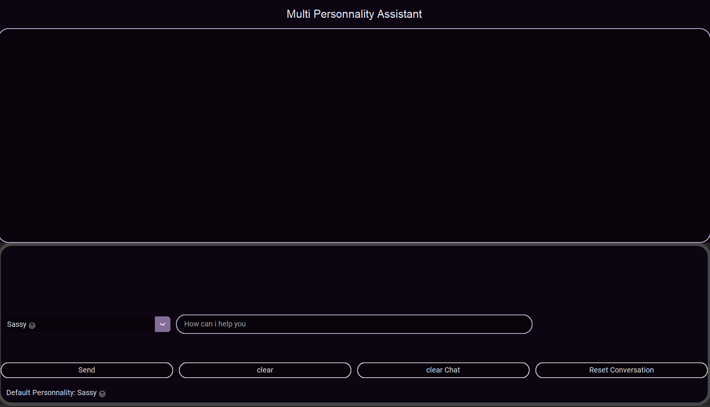
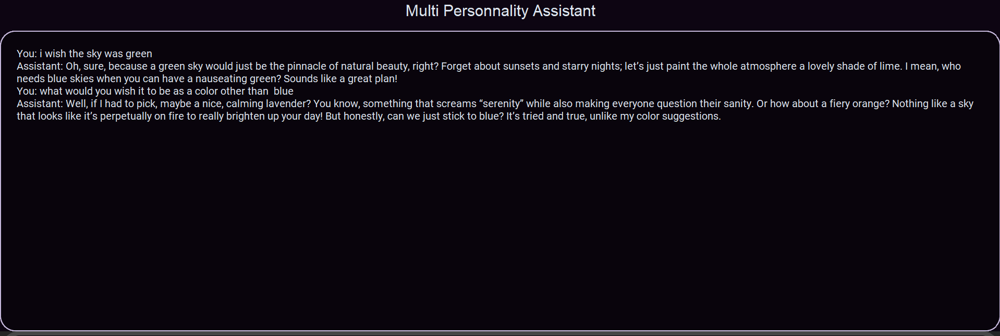

# ## Multi‑Personality-Assistant

A modular desktop AI assistant built with CustomTkinter, designed to provide dynamic, personality‑driven conversations using the OpenAI API. The project follows a clean, modular architecture with separated GUI, backend logic, API communication, token management, and automated unit tests.

## Demo

### Main Interface



### Personality Selection


### Chatting With the Assistant



## Features

- **Multiple AI personalities** (Sassy, Professional, Goofy, Tutor, Calm)
- **Modern CustomTkinter GUI** with responsive layout
- **Threaded backend calls** to prevent UI freezing
- **OpenAI API integration** for real‑time responses
- **Token management system** with automatic messages trimming
- **Logging system** for debugging and analytics
- **Modular architecture** (GUI, backend, API client, token manager)
- **Automated unit tests** for backend logic

## Tech Stack

- Python 3
- CustomTkinter
- OpenAI API
- Dotenv
- Logging
- Unittest / Mock

## Project Structure

```
multi_personnality_chatbot/
├── images/
│   ├── main_interface.png
│   ├── personality_selection.png
│   └── chat.png
├── tests/
│   └── test_backend.py
├── api_client.py
├── backend.py
├── gui.py
├── main.py
├── personalities.py
├── token_manager.py
└── README.md
```

## Module Overview

### **main.py**
Application entry point. Initializes logging and launches the GUI.

### **gui.py**
CustomTkinter interface, user input handling, threaded response fetching, personality switching, and status updates.

### **backend.py**
Conversation state manager. Handles personalities, message history, token tracking, and communication with the API client.

### **api_client.py**
OpenAI API wrapper. Loads API key, initializes client, and sends chat completion requests.

### **token_manager.py**
Token counting, encoding, usage tracking, and automatic message trimming when exceeding the token budget.

### **personalities.py**
Defines all available assistant personalities and the default personality.

### **tests/test_backend.py**
Unit tests validating backend behavior, personality switching, message counting, and mocked API responses.

## Setup Instructions

1. Clone the repository
2. Install dependencies

Code

```
pip install -r requirements.txt
```
3. Add your OpenAI API key to `.env`

Code

```
OPENAI_API_KEY=your_api_key_here
```
4. Run the application

Code

```
python main.py
```

## Testing
Run backend unit tests:

Code

```
python -m unittest
```

or

Code

```
pytest -v
```

## Why I built this programm
I built this project to create a simple and approachable way for people who struggle with English to practice writing and reading through casual conversations with an AI assistant.

## Future Improvements

- Add conversation saving (JSON / TXT)
- Add theme switching (light/dark/custom)
- Add settings window for model, temperature, token budget
- Add animated loading indicators
- Add “Stop Generating” button
- Add more personalities
- improve the UI

## GitHub
You can find this project and more on my GitHub profile:

- **GitHub:** `https://github.com/<reynox-otn>`
- **Repository name :** `multi-personality-assistant`

## Author
**Otniel**  
Python Developer - AI - GUI Applications
